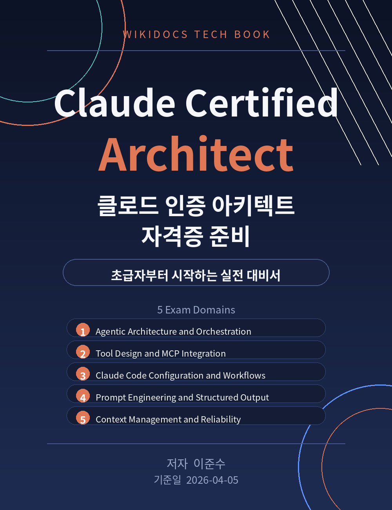

# 00. 첫 페이지

Claude Certified Architect 자격증 준비
클로드 인증 아키텍트 자격증 준비

초급자부터 시작하는 실전 대비서

저자: 이준수
기준일: 2026-04-05
저장소: https://github.com/1130dlwltn2-sondol/Claude-architect-Certification

---

이 책은 Anthropic의 Claude Certified Architect – Foundations(CCA-F) 시험을 준비하는 사람을 위한 실전 대비서입니다. 시험의 5개 평가 도메인을 순서대로 다루며, 각 장마다 예제와 실습, 확인 문제를 함께 제공합니다.

시험 제도와 출제 범위는 변경될 수 있습니다. 응시 전에는 반드시 공식 시험 가이드와 Anthropic Partner Academy의 최신 안내를 확인하시기 바랍니다.

문의

- 이메일: 1130dlwltn2@gmail.com
- 인공지능 정보공유 단톡방 참여 문의: https://open.kakao.com/o/s4OEqBai

이 책의 내용은 학습 목적으로 자유롭게 활용할 수 있습니다. 다만 시험의 실제 문항을 무단으로 복제하거나 공유하는 행위는 관련 규정을 위반할 수 있으니 유의하시기 바랍니다.
