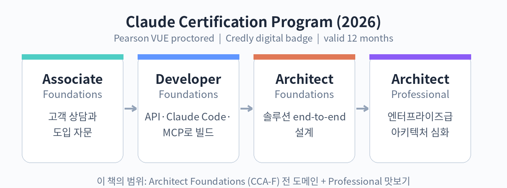

# 10. Claude 인증 프로그램 개요

## 자격증이 생긴 배경

2026년 3월, Anthropic은 Claude Partner Network를 출범하며 1억 달러 규모의 파트너 지원 계획을 발표했습니다. 교육 과정, 기술 지원, 공동 마케팅이 포함된 이 계획에서 눈에 띄는 대목은 "새로운 기술 자격증에 대한 즉시 접근"이었습니다. 같은 달 공개된 Claude Certified Architect – Foundations(CCA-F)가 바로 그 자격증입니다.

왜 하필 이때 자격증이었을까요. 기업들의 AI 도입이 파일럿을 넘어 실제 운영 단계로 넘어가면서, "Claude를 다룰 줄 아는 사람"을 가려내는 기준이 필요해졌습니다. Accenture는 3만 명, Deloitte는 47만 명 규모의 Claude 교육을 시작했고, Cognizant, KPMG, Infosys, PwC 같은 대형 컨설팅사들이 Claude 실무 조직을 만들었습니다. 사람이 많아지면 실력을 증명하는 방법이 필요해지고, 그 역할을 자격증이 맡게 됩니다.

2026년 7월에는 프로그램이 한 단계 확장됩니다. Pearson과의 협력으로 시험 운영 인프라를 갖추고, 4종의 역할 기반 자격증 체계를 발표했습니다. 모든 시험은 감독하에 치러지고, 신원 확인을 거치며, 합격자에게는 Credly를 통한 디지털 배지가 발급됩니다.

## 4종의 자격증

| 자격증 | 대상 | 핵심 역량 |
|---|---|---|
| Associate: Foundations | 고객 상담, 도입 자문 담당자 | Claude 활용과 업무 적용 판단 |
| Developer: Foundations | API와 도구로 직접 만드는 개발자 | Claude API, Claude Code, MCP 활용 |
| Architect: Foundations | 솔루션을 끝까지 설계하는 사람 | 5개 도메인의 설계와 구현 역량 |
| Architect: Professional | 엔터프라이즈급 설계자 | 대규모 아키텍처 심화 |

이 책은 Architect: Foundations(CCA-F)를 정면으로 다룹니다. 시험의 5개 도메인을 모두 커버하고, Professional을 준비하는 독자를 위한 안내도 마지막 장에 담았습니다. Developer나 Associate를 노리는 독자에게도 API, MCP, 프롬프트 파트는 그대로 유용합니다.

## 왜 아키텍트인가

"아키텍트"라는 이름 때문에 오해하기 쉽습니다. 이 시험은 설계 문서를 쓰는 시험이 아니라, 구현을 아는 사람이 푸는 시험입니다. 공식 안내에서 말하는 이상적인 응시자는 Agent SDK와 MCP, Claude Code CLI를 직접 다뤄본 사람입니다. 에이전트 루프를 어떻게 설계하는지, 멀티 에이전트를 어떤 패턴으로 엮는지, 세션 상태를 어떻게 관리하는지를 묻습니다.

즉, 자격증 이름은 아키텍트이지만 공부 방법은 개발자에 가깝습니다. 이 책이 예제 코드와 실습을 전면에 배치한 이유입니다.

## 시장의 평가

자격증의 가치는 결국 시장에서 정해집니다. 긍정적인 신호는 분명합니다. 첫째, 시험 자체가 시나리오 기반입니다. 6개의 실제 운영 시나리오 중 4개가 출제되며, 단순 암기로는 풀 수 없게 설계되어 있습니다. 둘째, 파트너 네트워크 4만여 개 기업이 지원했고, 1만 명 이상의 컨설턴트가 이미 자격을 취득했습니다(2026년 9월 기준 공식 발표). 셋째, 감독 시험과 신원 확인, 디지털 배지라는 장치는 자격의 신뢰도를 떠받칩니다.

다만 냉정하게 볼 지점도 있습니다. 자격 유효기간이 12개월로 짧고, 응시에 파트너 네트워크 회원 자격이 필요합니다. 자격증이 취업이나 프로젝트 수주를 보장하지는 않습니다. 이 책의 입장은 분명합니다. 자격증은 목표가 아니라 결과여야 합니다. 에이전트 시스템을 설계하고 운영하는 실력을 쌓으면, 자격증은 따라옵니다.

확인 문제

1. Claude 인증 프로그램이 4종 체계로 확장된 시점과 함께 발표된 시험 운영 파트너는?
2. Architect: Foundations와 Architect: Professional의 대상 차이를 한 문장으로 설명해 보세요.
3. 이 시험이 "구현을 아는 사람이 푸는 시험"이라고 한 이유를 설명해 보세요.
