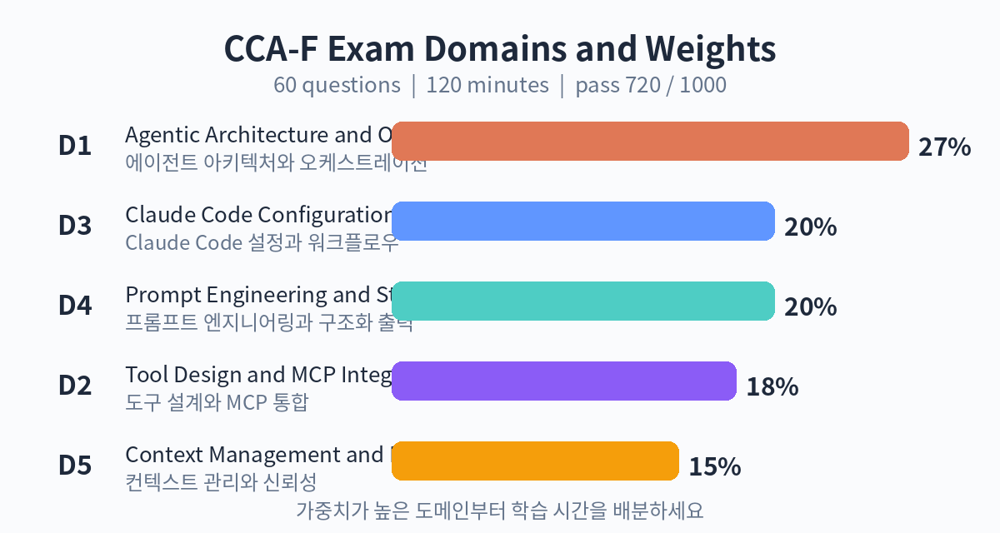

# 11. CCA-F 시험 안내

## 시험 형식 한눈에 보기

| 항목 | 내용 |
|---|---|
| 시험명 | Claude Certified Architect – Foundations (CCA-F) |
| 문항 수 | 60문항 (객관식, 복수 응답 포함) |
| 시험 시간 | 120분 |
| 합격 점수 | 1,000점 만점에 720점 (난이도 가중 scaled score) |
| 응시료 | 125달러 (시험 가이드 v0.2, 2026년 6월 기준) |
| 시험 방식 | 감독 시험 (Pearson VUE 테스트 센터 또는 온라인 감독) |
| 출제 방식 | 6개 실제 운영 시나리오 중 4개가 출제됨 |
| 결과 발표 | 2영업일 이내, 도메인별 성적표 제공 |
| 자격 유효기간 | 12개월 |
| 배지 | Credly 디지털 배지 |

시험은 closed-book입니다. AI 도구의 도움을 받을 수 없고, 휴식 시간도 없습니다. 한 번의 세션에서 60문항을 모두 풀어야 합니다.

합격 점수 720점은 단순 정답률이 아닙니다. 문항 난이도를 반영한 scaled score라서, 같은 720점이라도 시험 폼마다 필요한 정답 개수가 조금씩 다릅니다. 성적표에는 도메인별 정답률이 표시되므로, 불합격하더라도 어디를 보완해야 할지 알 수 있습니다.

## 5개 평가 도메인

| 도메인 | 내용 | 비중 |
|---|---|---|
| D1 | Agentic Architecture and Orchestration | 27% |
| D2 | Tool Design and MCP Integration | 18% |
| D3 | Claude Code Configuration and Workflows | 20% |
| D4 | Prompt Engineering and Structured Output | 20% |
| D5 | Context Management and Reliability | 15% |

D1이 27%로 가장 큽니다. 에이전트 루프 설계, 멀티 에이전트 오케스트레이션(coordinator-subagent 패턴), 작업 분해, 세션 상태 관리와 워크플로우 강제 같은 주제가 여기 속합니다.

D2는 도구를 어떻게 설계하고 MCP로 연결하는지를 봅니다. 도구의 이름과 설명 작성법, JSON Schema 파라미터 정의, MCP의 host-client-server 구조와 전송 방식이 핵심입니다.

D3은 Claude Code의 설정과 워크플로우입니다. CLAUDE.md, 슬래시 커맨드, 서브에이전트, hooks, MCP 서버 연동 같은 실제 사용법을 묻습니다.

D4는 프롬프트 엔지니어링과 구조화 출력입니다. 명확한 지시, 예시 제공, 시스템 프롬프트 설계, JSON Schema 기반 출력 제어가 출제됩니다.

D5는 컨텍스트 관리와 신뢰성입니다. 컨텍스트 윈도우의 경제학, 프롬프트 캐싱, 요약과 압축, 재시도와 폴백, 모니터링이 포함됩니다.

## 시나리오형 출제

이 시험의 특징은 6개의 실제 운영 시나리오 은행에서 4개를 뽑아 출제한다는 점입니다. 예를 들어 "고객 지원 에이전트를 설계하라" 같은 상황이 주어지고, 그 안에서 아키텍처 선택, 도구 설계, 컨텍스트 전략을 묻는 식입니다.

시나리오형 문항에 잘 대응하는 방법은 하나입니다. 각 도메인의 원칙을 "언제, 왜"와 함께 이해하는 것입니다. 라우팅 패턴이 언제 유리한지, 프롬프트 캐싱이 언제 비용을 아끼는지를 상황과 연결해서 기억해야 합니다. 이 책의 각 장은 개념 뒤에 항상 "언제 쓰는가"를 붙인 이유가 여기에 있습니다.

## 응시 절차

1. Claude Partner Network에 가입합니다. Claude를 시장에 내놓는 조직이라면 무료로 가입할 수 있습니다.
2. Anthropic Partner Academy(Skilljar 기반)에 로그인합니다. 여기서 공식 준비 과정(무료)을 수강할 수 있습니다.
3. 시험을 신청하고 응시료를 결제합니다.
4. Pearson VUE에서 테스트 센터 또는 온라인 감독 일정을 예약합니다.
5. 신원 확인을 거쳐 시험에 응시합니다.

준비 과정은 파트너 회원 자격 없이도 공개 과정으로 들을 수 있는 것이 많습니다. 시험 등록 단계에서만 파트너 네트워크 소속이 필요합니다. 응시 전에 공식 시험 가이드의 최신 버전을 반드시 확인하세요. 응시료와 정책은 바뀔 수 있습니다.

## 약어 표기 안내

공식 자료와 커뮤니티 자료에서 약어가 조금씩 다르게 쓰입니다. Architect Foundations는 CCA-F로 가장 많이 표기되며, CCAR-F라는 표기도 볼 수 있습니다. 이 책에서는 CCA-F를 표준으로 쓰고, 인용 자료에 다른 표기가 있으면 그대로 둡니다. Associate는 CCAO-F, Developer는 CCDV-F, Professional은 CCAR-P로 표기되는 경우가 많습니다.

확인 문제

1. 120분에 60문항이면 문항당 몇 분인가요? 시나리오형 문항을 고려할 때 시간 배분 전략을 세워 보세요.
2. 5개 도메인의 가중치를 큰 순서대로 나열해 보세요.
3. scaled score 방식에서 720점이 의미하는 바를 설명해 보세요.
