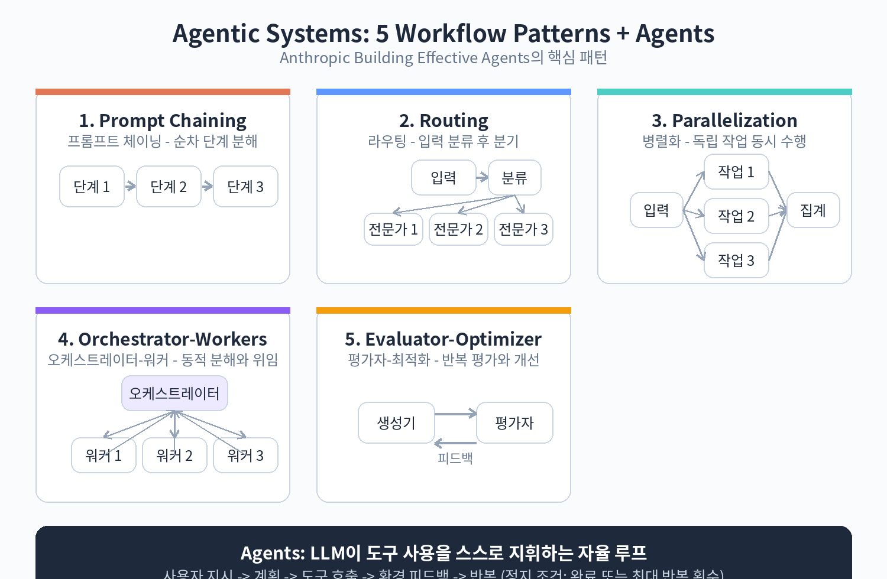

# 20. 에이전트와 워크플로우의 기초



이 장부터 시험 비중 27%의 Domain 1에 들어갑니다. 에이전트라는 말은 여기저기서 쓰이지만, 시험에서는 Anthropic의 정의를 정확히 알아야 합니다.

## 에이전트 시스템이란

Anthropic은 LLM을 쓰는 시스템을 크게 두 가지로 나눕니다.

워크플로우(workflow)는 LLM과 도구가 미리 정해진 코드 경로를 따라 움직이는 시스템입니다. 순서를 사람이 정합니다.

에이전트(agent)는 LLM이 스스로 자신의 과정과 도구 사용을 지휘하는 시스템입니다. 순서를 모델이 정합니다.

둘을 합쳐 에이전트 시스템(agentic system)이라고 부릅니다. 시험에서 "에이전트를 설계하라"는 말이 나오면, 이 구분부터 떠올리세요. 정해진 순서로 충분한 일에 에이전트를 쓰는 것은 과잉 설계입니다.

## 기본 블록: Augmented LLM

모든 에이전트 시스템의 출발점은 증강된 LLM(augmented LLM)입니다. 기본 모델에 검색(retrieval), 도구(tools), 메모리(memory)를 붙인 형태입니다. 현재의 Claude는 스스로 검색어를 만들고, 적절한 도구를 고르고, 무엇을 기억할지 판단할 수 있습니다.

구현에서 중요한 것은 두 가지입니다. 첫째, 기능을 용도에 맞게 다듬을 것. 둘째, 모델이 쓰기 쉬운 인터페이스를 제공할 것. 도구의 이름과 설명이 모호하면 모델도 헤맵니다. 도구 설계의 자세한 내용은 Part 3에서 다룹니다.

## 5가지 워크플로우 패턴

### 1. 프롬프트 체이닝 (Prompt chaining)

작업을 단계별로 나누어, 앞 단계의 출력을 다음 단계의 입력으로 넣습니다. 중간에 프로그램으로 검사하는 게이트를 둘 수 있습니다.

언제 쓰는가: 작업이 명확한 하위 단계로 잘게 쪼개질 때. 지연 시간을 감수하고 정확도를 올리고 싶을 때.

예시: 마케팅 문구를 먼저 생성한 뒤, 다른 언어로 번역합니다. 문서 개요를 쓰고, 개요가 기준을 만족하는지 확인한 뒤, 본문을 씁니다.

### 2. 라우팅 (Routing)

입력을 분류해서 전문화된 후속 작업으로 보냅니다. 관심사를 분리하고, 입력 종류별로 특화된 프롬프트를 쓸 수 있습니다.

언제 쓰는가: 입력에 뚜렷한 종류가 있고, 종류마다 다르게 처리하는 것이 좋을 때. 분류 자체가 정확하게 될 때.

예시: 고객 문의를 일반 질문, 환불 요청, 기술 지원으로 나눕니다. 쉬운 질문은 가볍고 저렴한 모델에, 어려운 질문은 성능이 좋은 모델에 보냅니다.

### 3. 병렬화 (Parallelization)

여러 LLM 호출을 동시에 실행하고 결과를 모읍니다. 두 가지 변형이 있습니다.

섹셔닝(sectioning): 작업을 독립적인 하위 작업으로 나눠 병렬 실행합니다. 가드레일용 모델과 본 작업용 모델을 분리하는 것이 대표적입니다.

투표(voting): 같은 작업을 여러 번 실행해 다양한 출력을 얻습니다. 코드 취약점 검토를 여러 프롬프트로 돌리는 식입니다.

언제 쓰는가: 하위 작업이 독립적이라 병렬로 빨라질 때, 또는 여러 관점이 필요해 신뢰도를 높이고 싶을 때.

### 4. 오케스트레이터-워커 (Orchestrator-workers)

중앙의 LLM이 작업을 동적으로 나누고, 워커 LLM들에게 위임한 뒤 결과를 종합합니다. 병렬화와 비슷해 보이지만, 하위 작업이 미리 정해져 있지 않다는 점이 다릅니다. 오케스트레이터가 입력을 보고 그때그때 정합니다.

언제 쓰는가: 필요한 하위 작업을 미리 예측할 수 없을 때. 코딩 작업이 대표적입니다. 몇 개 파일을 어떻게 고쳐야 할지는 작업을 열어보기 전에는 모릅니다.

### 5. 평가자-최적화 (Evaluator-optimizer)

한 LLM이 답을 만들고, 다른 LLM이 평가와 피드백을 주는 것을 반복합니다.

언제 쓰는가: 평가 기준이 명확하고, 반복 개선이 실제로 도움이 될 때. 사람의 피드백을 말로 하면 답이 좋아지는 경우, 그리고 LLM이 그런 피드백을 줄 수 있는 경우가 해당합니다.

예시: 문학 번역의 뉘앙스를 다듬을 때. 여러 번 검색하고 분석해야 하는 복잡한 리서치에서, 평가자가 추가 검색이 필요한지 판단할 때.

## 에이전트: 자율 루프

에이전트는 도구를 쓰는 LLM이 환경 피드백을 받아 스스로 도는 루프입니다. 사람의 지시나 대화로 시작하고, 계획을 세워 독립적으로 움직이다가, 필요하면 사람에게 질문합니다. 매 단계마다 도구 실행 결과 같은 실제 근거(ground truth)를 확인하며 진행 상황을 판단합니다. 작업은 완료되면 끝나지만, 최대 반복 횟수 같은 정지 조건을 두는 것이 일반적입니다.

구현은 생각보다 단순합니다. 핵심은 도구 모음과 그 문서를 잘 설계하는 것입니다.

언제 쓰는가: 필요한 단계 수를 예측할 수 없고, 고정된 경로를 코드로 박을 수 없는 개방형 문제. 모델의 판단을 어느 정도 신뢰할 수 있는 환경에서, 작업을 확장하고 싶을 때.

주의할 점: 자율성은 비용 증가와 오류 누적의 가능성을 동반합니다. 샌드박스에서 충분히 테스트하고, 적절한 가드레일을 두어야 합니다.

## 예제: 라우팅 패턴의 의사코드

```python
def handle_inquiry(text):
    category = classify(text)  # LLM 호출 1: 분류
    if category == "refund":
        return refund_flow(text)      # 환불 전담 프롬프트
    elif category == "technical":
        return technical_flow(text)   # 기술 지원 전담 프롬프트
    else:
        return general_flow(text)     # 일반 응대 프롬프트
```

분류 단계와 처리 단계를 분리한 것이 핵심입니다. 한 번의 호출로 분류와 답변을 다 하려 하면, 어느 한쪽의 품질이 떨어집니다.

## 실습: 내 업무에 패턴 매칭하기

본인의 업무나 관심 분야에서 다음을 각각 하나씩 찾아봅니다.

1. 단계가 명확히 나뉘는 작업 (체이닝 후보)
2. 입력 종류가 3가지 이상으로 나뉘는 작업 (라우팅 후보)
3. 단계를 미리 알 수 없는 작업 (에이전트 후보)

각각에 대해 왜 그 패턴이 맞는지 한 문장으로 적어봅니다. 이 연습이 시나리오형 문항의 기본기가 됩니다.

## Anthropic의 세 가지 원칙

에이전트를 구현할 때 Anthropic이 강조하는 원칙입니다. 시험 단골 소재입니다.

1. 단순하게(simple): 설계는 단순하게 유지한다.
2. 투명하게(transparent): 에이전트의 계획 단계를 명시적으로 보여준다.
3. 인터페이스를 정성껏: 에이전트와 컴퓨터 사이의 접점, 즉 도구의 문서화와 테스트에 공을 들인다.

프레임워크는 시작을 빠르게 해주지만, 운영 단계로 갈수록 추상화를 걷어내고 기본 구성 요소로 직접 만드는 것을 주저하지 말라고 권합니다.

확인 문제

1. 워크플로우와 에이전트의 차이를 한 문장으로 설명해 보세요.
2. 오케스트레이터-워커와 병렬화(섹셔닝)의 차이는 무엇입니까?
3. 에이전트를 쓰지 말아야 할 상황을 두 가지 들어보세요.
4. 세 가지 원칙 중 도구 문서화가 왜 중요한지 설명해 보세요.
