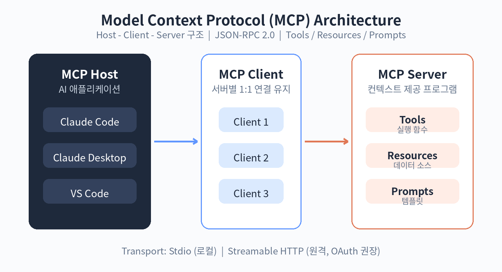

# 31. MCP 아키텍처 이해

MCP(Model Context Protocol)는 AI 애플리케이션이 외부 데이터와 도구에 연결되는 방식을 표준화한 프로토콜입니다. 2024년 말 Anthropic이 공개한 이후 업계 표준으로 자리 잡았고, 시험에서는 Domain 2의 핵심 주제로 다뤄집니다.

## 왜 MCP인가

MCP가 나오기 전에는 AI 앱마다 외부 연동 방식을 따로 만들었습니다. A라는 앱을 위한 연동 코드를 B라는 앱에서는 쓸 수 없었습니다. MCP는 이 연결을 표준화합니다. 한 번 만든 MCP 서버는 Claude Code, Claude Desktop, VS Code 등 어떤 MCP 호스트에서도 쓸 수 있습니다. "USB-C 같은 것"이라고 이해하면 쉽습니다.

## 참여자: Host, Client, Server

MCP는 클라이언트-서버 구조입니다.

MCP 호스트: AI 애플리케이션 자체입니다. Claude Code나 Claude Desktop이 여기에 해당합니다. 하나 또는 여러 개의 MCP 클라이언트를 관리합니다.

MCP 클라이언트: MCP 서버와의 연결을 유지하는 주체입니다. 호스트가 MCP 서버 하나당 클라이언트 하나를 만듭니다. 서버에서 컨텍스트를 가져와 호스트가 쓸 수 있게 합니다.

MCP 서버: 컨텍스트를 제공하는 프로그램입니다. 로컬에서 실행될 수도, 원격에서 실행될 수도 있습니다. "서버"라는 말이 꼭 원격 실행을 뜻하지는 않습니다.

예를 들어 VS Code가 Sentry의 MCP 서버에 연결하면, VS Code 런타임은 Sentry 서버와의 연결을 유지하는 클라이언트 객체를 만듭니다. 이어서 로컬 파일시스템 서버에 연결하면 클라이언트 객체를 하나 더 만듭니다.

## 두 개의 계층

MCP는 데이터 계층과 전송 계층으로 나뉩니다.

데이터 계층: JSON-RPC 2.0 기반의 프로토콜입니다. 메시지 구조와 의미를 정의하고, 버전 탐색과 세 가지 핵심 프리미티브(도구, 리소스, 프롬프트)를 다룹니다.

전송 계층: 통신 채널을 정의합니다. 연결 수립, 메시지 프레이밍, 인증을 담당합니다. 같은 JSON-RPC 메시지를 어떤 전송로로 보내느냐의 차이입니다.

## 세 가지 프리미티브

MCP 서버가 제공할 수 있는 핵심 기능 세 가지입니다. 시험 단골입니다.

도구(Tools): AI가 호출해 동작을 수행하는 실행 함수입니다. 파일 조작, API 호출, DB 조회 같은 일을 합니다. 30장에서 다룬 도구 설계가 그대로 적용됩니다.

리소스(Resources): AI에게 맥락을 주는 데이터 소스입니다. 파일 내용, DB 레코드, API 응답 같은 것입니다. 도구가 "행동"이라면 리소스는 "정보"입니다.

프롬프트(Prompts): LLM과의 상호작용을 구조화하는 재사용 템플릿입니다. 시스템 프롬프트나 few-shot 예시를 담습니다.

각 프리미티브는 탐색(list), 조회(get), 실행(call) 메서드를 가집니다. 클라이언트는 tools/list로 도구 목록을 가져온 뒤 tools/call로 실행합니다. 목록이 동적으로 바뀔 수 있게 설계된 점이 특징입니다.

클라이언트 측 프리미티브도 있습니다. Elicitation은 서버가 사용자에게 추가 정보를 요청하는 기능입니다. 확인이 필요한 동작 전에 사용자 입력을 받는 데 씁니다. 참고로 Sampling(서버가 클라이언트의 모델에 완성 요청)은 2026-07-28 버전부터 deprecated되었고, Logging도 새 구현에서는 stderr나 OpenTelemetry를 쓰도록 바뀌었습니다. 스펙의 변화를 묻는 문항에 대비해 알아두세요.

## 전송 방식

Stdio: 표준 입출력으로 로컬 프로세스끼리 직접 통신합니다. 네트워크 오버헤드가 없어 가장 빠릅니다. 로컬 MCP 서버의 기본 선택입니다.

Streamable HTTP: HTTP POST로 클라이언트에서 서버로 메시지를 보내고, 필요하면 Server-Sent Events로 스트리밍합니다. 원격 서버용입니다. Bearer 토큰, API 키, 커스텀 헤더 같은 표준 HTTP 인증을 쓰고, OAuth 사용을 권장합니다.

선택 기준은 단순합니다. 같은 머신에서 돌면 stdio, 원격이면 Streamable HTTP입니다.

## 탐색과 버전

클라이언트는 server/discover 요청으로 서버의 프로토콜 버전과 기능, 정체를 파악합니다. 버전 협상이 먼저 이루어진 뒤 실제 통신이 시작됩니다. 각 요청은 _meta 필드에 프로토콜 버전을 싣고 다닙니다.

## 예제: 파일시스템 MCP 서버의 하루

1. Claude Desktop이 로컬 파일시스템 MCP 서버를 stdio로 실행합니다
2. 호스트가 클라이언트를 만들고 server/discover로 기능을 확인합니다
3. 클라이언트가 resources/list로 읽을 수 있는 파일 목록을 가져옵니다
4. 사용자가 "이 폴더의 보고서 요약해줘"라고 하면, 모델이 resource를 읽고 tools/call로 필요한 처리를 합니다

## 실습: 개념 매핑

다음 상황에서 각각 무엇에 해당하는지 말해봅니다.

1. "Jira 티켓을 조회하는 기능"을 MCP로 제공한다면: 도구인가, 리소스인가?
2. "DB 스키마 설명"을 제공한다면: 무엇인가?
3. "코드 리뷰용 프롬프트 템플릿"을 제공한다면: 무엇인가?

정답: 1은 도구(조회라는 동작), 2는 리소스(정보), 3은 프롬프트(템플릿)입니다. 동작인지 정보인지 템플릿인지를 구분하는 감각이 중요합니다.

확인 문제

1. MCP 호스트, 클라이언트, 서버의 역할을 각각 설명해 보세요.
2. 세 가지 프리미티브를 "행동, 정보, 템플릿"으로 구분해 설명해 보세요.
3. stdio와 Streamable HTTP 중 언제 무엇을 쓰는지 설명해 보세요.
4. Sampling이 deprecated된 이유를 추론해 보세요.
