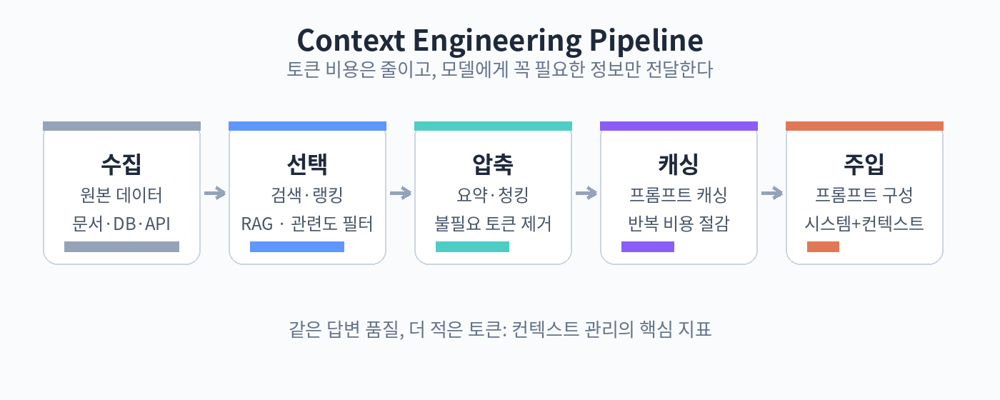

# 61. 컨텍스트 엔지니어링 실전



토큰을 아는 것을 넘어, 실제로 컨텍스트를 설계하는 방법을 다룹니다. 필요한 정보를 필요한 만큼, 필요한 때에 주는 기술입니다.

## 검색과 선택: RAG

RAG(Retrieval-Augmented Generation)는 필요한 문서를 그때그때 찾아서 프롬프트에 넣는 방식입니다. 문서 전체를 넣는 대신, 질문과 관련된 부분만 넣습니다.

기본 흐름:

1. 문서를 작은 조각(청크)으로 나눠 벡터 DB에 저장
2. 질문이 오면 관련도 높은 청크를 검색
3. 상위 N개만 프롬프트에 포함

시험 포인트는 "언제 RAG를 쓰는가"입니다. 모델이 모르는 최신 정보, 사내 문서, 대용량 데이터가 필요할 때 씁니다. 모델이 이미 아는 일반 지식에는 RAG가 불필요합니다.

청킹 전략도 중요합니다. 너무 크게 나누면 관련 없는 내용이 섞이고, 너무 작게 나누면 맥락이 끊깁니다. 문서의 구조(제목, 섹션)를 살려 나누는 것이 기본입니다.

## 요약과 압축

긴 대화나 문서는 요약해서 다음 단계로 넘깁니다. 에이전트의 세션 상태 관리(21장)에서 쓰는 기법입니다.

요약 시 주의점:

- 숫자, 고유명사, 결정 사항은 요약에서 빠지면 안 됩니다
- "나중에 필요할 수 있는" 정보의 기준을 정합니다
- 요약 자체도 토큰을 쓰므로, 요약 주기를 정합니다 (예: 10턴마다)

Claude Code의 /clear와 컴팩트 기능도 같은 원리입니다. 대화가 길어지면 이전 내용을 요약하고 새로 시작합니다.

## 프롬프트 캐싱

반복되는 긴 입력(시스템 프롬프트, 대용량 문서)은 캐싱하면 비용과 속도를 아낄 수 있습니다. 첫 호출에서 캐시를 만들고, 이후 호출에서 재사용합니다.

캐싱이 효과적인 경우:

- 같은 문서 뭉치를 여러 질문에 반복해서 쓰는 경우
- 시스템 프롬프트가 길고 고정된 경우
- 멀티턴 대화에서 앞부분이 그대로 유지되는 경우

주의점: 캐시는 접두사(prefix) 기준입니다. 앞부분이 조금이라도 바뀌면 캐시가 깨집니다. 변하는 내용은 뒤에 배치하는 것이 캐시 효율을 높입니다.

## 메모리 패턴

장기간 이어지는 작업에서는 메모리가 필요합니다.

- 단기 메모리: 현재 세션의 대화 기록
- 작업 메모리: 지금 하는 일의 중간 상태 (21장의 세션 상태)
- 장기 메모리: 여러 세션에 걸친 사용자 정보, 선호도

장기 메모리는 보통 외부 저장소에 두고 필요할 때 읽어옵니다. "사용자가 지난번에 뭘 좋아했는지" 같은 정보를 매번 프롬프트에 다 넣는 것은 낭비입니다.

## 컨텍스트 오염 방지

서브에이전트(21장, 41장)를 쓰는 이유 중 하나가 컨텍스트 분리입니다. 메인 에이전트의 컨텍스트에 세부 작업의 중간 과정이 쌓이면, 정작 중요한 판단에 방해가 됩니다.

원칙:

- 세부 작업은 서브에이전트에 위임하고 결과만 받는다
- 디버깅용 상세 로그는 별도 저장소에 둔다
- 한 세션에는 한 가지 큰 작업만 한다

## 예제: 캐싱 구조 설계

사내 문서를 기반으로 답하는 지원 챗봇:

```
[캐시 영역 - 고정]
시스템 프롬프트 (500토큰)
자주 참조되는 핵심 문서 10건 (20,000토큰)

[비캐시 영역 - 매번 변경]
사용자 질문 (200토큰)
검색된 추가 문서 (2,000토큰)
```

질문이 바뀌어도 앞부분은 그대로라 캐시가 유지됩니다. 건당 20,500토큰을 아끼는 구조입니다.

## 실습: RAG 파이프라인 스케치

이 책의 앞 장들을 "문서" 삼아 RAG를 설계해 봅니다(코드는 선택).

1. 어떤 단위로 청크를 나눌 것인가 (장? 절? 단락?)
2. 질문 "MCP의 세 가지 프리미티브는?"에 어떤 청크가 검색되어야 하는가
3. 검색된 청크를 프롬프트에 어떻게 배치할 것인가

종이에 그리는 것만으로 RAG의 설계 감각이 생깁니다.

확인 문제

1. RAG를 써야 하는 경우 3가지를 들어보세요.
2. 요약에서 빠지면 안 되는 정보 3가지를 말해 보세요.
3. 프롬프트 캐싱에서 접두사가 중요한 이유를 설명해 보세요.
4. 컨텍스트 오염이란 무엇이며, 어떻게 막나요?
